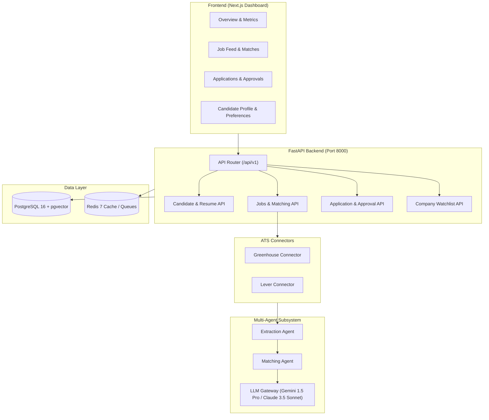

# JobPilot AI — Architecture Documentation

## Overview

JobPilot AI is an autonomous, multi-agent personal recruitment intelligence and job application automation platform. It monitors company career boards, extracts structured job requirements, computes multi-dimensional match scores against a candidate profile, crafts customized resumes/cover letters, and prepares applications for human-in-the-loop review.

## Core Components

### 1. Backend Service (`backend/app`)
- **FastAPI Framework**: High performance async web framework.
- **SQLAlchemy 2.0 Async**: Non-blocking ORM operations using `asyncpg`.
- **Alembic**: Database migrations and schema version management.
- **Pydantic v2**: Strict data validation and settings management.

### 2. Multi-Agent Engine (`backend/app/agents`)
- **BaseAgent**: Abstract foundation providing standard lifecycle execution, structured logging, and duration telemetry.
- **ExtractionAgent**: Heuristic + regex + LLM extraction for skills, experience requirements, and location types from raw postings.
- **MatchingAgent**: Weighted multi-criteria scoring algorithm:
  - Skill Match: 30%
  - Role Title Match: 25%
  - Experience Alignment: 15%
  - Location Preference: 10%
  - Salary Compatibility: 10%
  - Education Requirement: 10%
  - Generates classifications: `strong` (>=85), `good` (>=70), `review` (>=55), `low` (<55).
- **LLM Gateway**: Provider-agnostic gateway supporting Google Gemini and Anthropic Claude.

### 3. Connectors Subsystem (`backend/app/connectors`)
- **BaseConnector**: Unified interface (`fetch_jobs`, `parse_job`).
- **Greenhouse Connector**: Direct integration with Greenhouse public boards API (`/v1/boards/{company}/jobs`).
- **Lever Connector**: Direct integration with Lever Postings API (`/v0/postings/{company}`).

### 4. Storage & Persistence
- **PostgreSQL 16 + pgvector**: Relational storage for profiles, jobs, applications, and semantic embeddings.
- **Redis 7**: Distributed caching and asynchronous task queuing.
