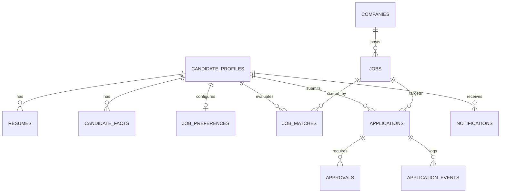

# JobPilot AI — Database Schema Documentation

## Overview

The JobPilot AI database is built with PostgreSQL 16 (with pgvector support). The schema models the entire job discovery, candidate profiling, intelligent matching, and application automation workflow.

## Entity Relationship Diagram

## Tables & Schemas

### 1. `candidate_profiles`
Stores the candidate's core identity, contact information, and high-level summary.
- `id` (UUID, PK)
- `full_name` (VARCHAR(255))
- `email` (VARCHAR(255), UNIQUE)
- `phone` (VARCHAR(50))
- `location` (VARCHAR(255))
- `linkedin_url`, `github_url`, `portfolio_url` (VARCHAR(500))
- `summary` (TEXT)
- `experience_years` (FLOAT)
- `is_active` (BOOLEAN)
- `created_at`, `updated_at` (TIMESTAMP)

### 2. `resumes`
Stores uploaded PDF/DOCX resumes and parsed text.
- `id` (UUID, PK)
- `candidate_id` (UUID, FK -> `candidate_profiles.id`)
- `version` (INTEGER)
- `file_path` (VARCHAR(1000))
- `file_name` (VARCHAR(255))
- `file_type` (VARCHAR(10)) - `pdf` or `docx`
- `extracted_text` (TEXT)
- `is_original` (BOOLEAN)
- `target_role` (VARCHAR(255))
- `target_job_id` (UUID)
- `is_verified` (BOOLEAN)
- `created_at` (TIMESTAMP)

### 3. `candidate_facts`
Discrete, verified facts extracted from resumes (skills, education, achievements, tools).
- `id` (UUID, PK)
- `candidate_id` (UUID, FK -> `candidate_profiles.id`)
- `fact_type` (VARCHAR(50)) - `skill`, `education`, `experience`, `project`
- `fact_data` (JSONB)
- `source` (VARCHAR(100))
- `is_verified` (BOOLEAN)
- `created_at` (TIMESTAMP)

### 4. `job_preferences`
Candidate criteria for job matching, discovery, and automation schedules.
- `id` (UUID, PK)
- `candidate_id` (UUID, FK -> `candidate_profiles.id`, UNIQUE)
- `target_roles` (JSONB)
- `preferred_locations` (JSONB)
- `work_types` (JSONB) - `remote`, `hybrid`, `onsite`
- `min_salary`, `max_salary` (INTEGER)
- `experience_level` (VARCHAR(50))
- `experience_years` (FLOAT)
- `discovery_morning`, `discovery_evening` (VARCHAR(10))
- `discovery_timezone` (VARCHAR(50))
- `llm_provider` (VARCHAR(50))

### 5. `companies`
Curated and discovered companies with career portal identifiers.
- `id` (UUID, PK)
- `name` (VARCHAR(255), UNIQUE)
- `domain` (VARCHAR(255))
- `careers_url` (VARCHAR(1000))
- `ats_platform` (VARCHAR(100)) - `greenhouse`, `lever`, `workday`, `custom`
- `ats_identifier` (VARCHAR(255))
- `location`, `industry` (VARCHAR(255))
- `is_in_watchlist` (BOOLEAN)
- `is_verified` (BOOLEAN)
- `discovery_source` (VARCHAR(100))
- `last_discovered_at` (TIMESTAMP)
- `extra_metadata` (JSONB)

### 6. `jobs`
Discovered job postings.
- `id` (UUID, PK)
- `company_id` (UUID, FK -> `companies.id`)
- `source` (VARCHAR(100))
- `source_id` (VARCHAR(500))
- `title` (VARCHAR(500))
- `description` (TEXT)
- `location`, `location_type`, `department`, `employment_type`
- `experience_min`, `experience_max` (INTEGER)
- `salary_min`, `salary_max`, `salary_currency`
- `required_skills`, `preferred_skills` (JSONB)
- `education_requirement` (VARCHAR(255))
- `application_url` (VARCHAR(1000))
- `deadline`, `posted_at`, `discovered_at` (TIMESTAMP)
- `raw_payload` (JSONB)
- `is_active` (BOOLEAN)
- Unique Constraint: `(source, source_id)`

### 7. `job_matches`
Calculated match scores between candidate facts and job requirements.
- `id` (UUID, PK)
- `job_id` (UUID, FK -> `jobs.id`)
- `candidate_id` (UUID, FK -> `candidate_profiles.id`)
- `overall_score`, `skill_score`, `role_score`, `experience_score`, `location_score`, `salary_score`, `education_score` (FLOAT)
- `matched_skills`, `missing_skills` (JSONB)
- `explanation` (TEXT)
- `is_eligible` (BOOLEAN)
- `eligibility_notes` (TEXT)
- `classification` (VARCHAR(50)) - `strong`, `good`, `review`, `low`
- `created_at` (TIMESTAMP)

### 8. `applications` & `approvals`
Tracks the preparation, review, and submission of applications.
- `applications`: `status` (`discovered`, `preparing`, `pending_approval`, `approved`, `rejected`, `submitted`), `resume_id`, `cover_letter_path`, `prepared_answers` (JSONB), `is_ready` (BOOLEAN).
- `approvals`: human reviewer decisions (`pending`, `approved`, `rejected`), notes, timestamps.
- `application_events`: audit trail for status transitions and automated actions.
- `notifications`: user alerts for high-priority matches and approvals needed.
- `agent_runs` & `company_discovery_logs`: execution logs and agent metrics.
